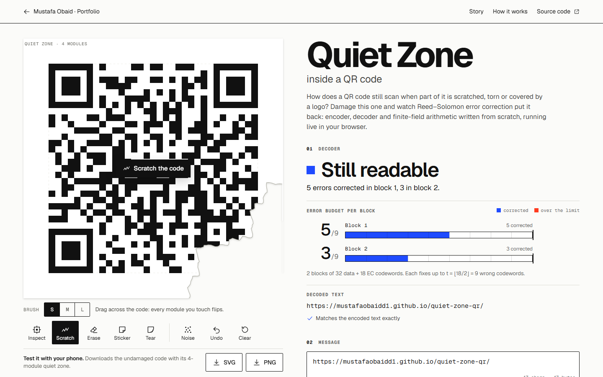

# Quiet Zone — inside a QR code

Scratch, tear or cover a QR code and watch Reed–Solomon error correction put it back: a QR encoder
and decoder written from scratch, with every step explained.

**Live demo:** https://mustafaobaidd1.github.io/quiet-zone-qr/



## The question

How does a QR code still scan when part of it is scratched, torn, or covered by a logo?

The page opens on the address of the page itself, encoded as a version 4-M symbol with its
bottom-right corner torn away. The decoder reports **“Still readable — 5 errors corrected in block 1,
3 in block 2.”** Drag across the code and every module you touch flips; the decoder runs again on
every pointer move. Push past the limit and it says, for example, **“Unreadable — Block 2 has 12
errors, it can fix at most 9”**, and tints that block on the code.

## Features

- **Encoder** (from scratch): numeric, alphanumeric and byte (UTF-8) modes with an optimal
  automatic split into segments; versions 1–40; levels L/M/Q/H; smallest version chosen
  automatically (or forced); all 8 masks scored with the four penalty rules, with the scores shown;
  BCH-coded format and version information.
- **Damage tools**: scratch brush (flips modules, three sizes), eraser, logo sticker, random noise
  with probability p, torn corner; undo (Ctrl+Z), redo (Ctrl+Shift+Z) and clear. Damage is stored in
  symbol-relative coordinates, so it stays put when you change the text and the version changes.
- **Decoder** working from the module grid: format information with BCH error correction (both
  copies), version information (v ≥ 7), unmasking, zig-zag extraction, de-interleaving, Reed–Solomon
  decoding per block (syndromes, Berlekamp–Massey, Chien search, Forney), segment parsing (numeric,
  alphanumeric, byte, Kanji, ECI) to text. Optional **erasure decoding** for codewords under stickers.
- **Readout**: live status with the exact reason for a failure, per-block error budget meters
  (errors found vs t, or 2e + f vs n − k with erasures), decoded text, and a check against the
  original that catches miscorrections (“Misread”).
- **Anatomy**: hover or tap any module to see its role (finder, separator, timing, alignment, format
  bit i of copy c, version bit, dark module, data bit k of codeword n in block b, EC codeword,
  remainder bit); the codeword is outlined and its block tinted. Region layers isolate any part.
- **Story mode**: an eight-step stepper on your own message — text → bits, codewords and padding,
  Reed–Solomon long division (animated shift register), interleaving (animated), zig-zag placement
  (animated path), masking and penalties, format information (BCH division), damage and recovery
  (syndromes, Berlekamp–Massey iterations, Chien roots, Forney magnitudes).
- **Export** the undamaged code as SVG or PNG with its 4-module quiet zone, ready for a phone camera.
- **How it works**: GF(256) arithmetic with an interactive calculator and log/antilog tables, why
  t = ⌊(n − k)/2⌋, decoding equations, blocks and interleaving, masks, format/version BCH codes, and
  the quiet zone itself.

## How it works

**Finite field.** Codewords are elements of GF(2⁸) built on the primitive polynomial
p(x) = x⁸ + x⁴ + x³ + x² + 1 (0x11D). Addition is XOR; multiplication uses log/antilog tables of
α = 2, so a·b = α^((log a + log b) mod 255).

**Reed–Solomon encoding.** Each block of k data codewords is the polynomial m(x); the n − k EC
codewords are the remainder of m(x)·x^(n−k) divided by g(x) = ∏ᵢ₌₀^(n−k−1) (x − αⁱ). Every codeword
therefore vanishes at α⁰ … α^(n−k−1).

**Capacity.** RS codes are MDS: two codewords differ in at least d = n − k + 1 positions, so up to
t = ⌊(n − k)/2⌋ wrong codewords are correctable, or more generally e errors and f erasures with
2e + f ≤ n − k.

**Decoding** (per block): syndromes Sⱼ = r(αʲ); erasure locator Γ(x) and erasure-adjusted
(Forney) syndromes; Berlekamp–Massey for the error locator σ(x); errata locator Λ = σΓ; evaluator
Ω(x) = S(x)Λ(x) mod x^(n−k); Chien search over the block’s positions; Forney magnitude
eₗ = Xₗ Ω(Xₗ⁻¹)/Λ′(Xₗ⁻¹) (first consecutive root α⁰). A block is declared uncorrectable when
2·deg σ + f > n − k, when Λ has fewer roots in the block than its degree, or when the corrected word
still has non-zero syndromes.

**Symbol.** Interleaving, the zig-zag placement path, the eight masks (ISO/IEC 18004 Table 10) and
the penalty rules N1 = 3, N2 = 3, N3 = 40, N4 = 10 follow the standard as reproduced in Thonky’s
tutorial (rule 3 as 1:1:3:1:1 runs with four light modules on one side, inside the symbol; rule 4 by
the previous and next multiples of 5%). Format information is a (15, 5) BCH code (generator 0x537,
mask 0x5412), version information an (18, 6) BCH code (generator 0x1F25); both are decoded by
nearest-codeword search (corrects up to 3 bit errors per copy).

**Damage model.** Units are modules. Scratches flip every module whose centre is within the brush
radius of the stroke (once per stroke); torn paper and stickers read as light modules; noise flips
each module independently with probability p (seeded, so it replays exactly).

## Validation

This is a **validated encoder/decoder** for what it claims: standard QR symbols from text, and
decoding from a module grid with Reed–Solomon error and erasure correction. It is an **educational
simulation** only in its damage model. Unit tests (`npm test`) and a larger suite
(`npm run validate`) check:

| Check                                           | Reference                                       | Result                                                                 |
| ----------------------------------------------- | ----------------------------------------------- | ---------------------------------------------------------------------- |
| HELLO WORLD 1-Q data + EC codewords             | Thonky tutorial; CVUT course notes              | 13 + 13 codewords exact                                                |
| HELLO WORLD 1-Q mask and format                 | standard penalty rules                          | mask 6 at 314 (next: mask 0 at 347), format `010111011011010`          |
| HELLO WORLD 1-M data + EC, first division steps | Thonky error-correction page                    | exact                                                                  |
| 5-Q, four blocks                                | Thonky “structure final message”                | all 4 × 18 EC codewords and the 134-codeword interleaved message exact |
| “’Twas brillig” 1-M byte mode                   | Wikiversity, _Reed–Solomon codes for coders_    | data and EC codewords exact                                            |
| Block structure, capacities, alignment centres  | ISO/IEC 18004 Tables 7, 9, Annex E (via Thonky) | 160/160 rows, 640/640 capacities, 39/39 versions                       |
| Format and version strings                      | ISO/IEC 18004 Annexes C, D                      | 32/32 and 34/34                                                        |
| GF(256) field axioms                            | exhaustive                                      | all 16 777 216 triples (associativity, distributivity), all inverses   |
| Generator polynomials (degrees 7–30)            | Thonky generator tool                           | 11/11                                                                  |
| RS, 2e + f ≤ n − k, 10 block shapes             | random, `npm run validate`                      | 10 000/10 000 corrected exactly                                        |
| RS, t + 1 … t + 5 errors                        | random, `npm run validate`                      | 10 000/10 000 flagged uncorrectable, 0 miscorrections                  |
| Format BCH, every 15-bit word                   | exhaustive                                      | 18 432/18 432 words within distance 3 decoded, 14 336 others rejected  |
| Our encoder → **jsQR**                          | 2000 random strings, all 40 versions, 4 levels  | 2000/2000 identical                                                    |
| **qrcode** (npm) → our decoder                  | 2000 random strings, all 40 versions, 4 levels  | 2000/2000 identical                                                    |
| Module-for-module equality with qrcode          | same text, version and mask, 24 combinations    | identical                                                              |
| Exported PNG                                    | jsQR in the browser (E2E)                       | decodes to the page address                                            |

A finding along the way: jsQR 1.4.0 lists the alignment centres of version 23 as 6, 30, 54, 74, 102
(the standard says 6, 30, 54, **78**, 102). It misreads every version-23 symbol, from any encoder,
and fails outright at 23-L; the interoperability tests re-encode those at version 24 for jsQR and
document the defect.

Robustness to random module flips (page address, 200 seeded trials per cell, share still readable):

| Level | Version | p = 1% | 2%  | 3%  | 5%  | 8%  |
| ----- | ------- | ------ | --- | --- | --- | --- |
| L     | 3       | 87%    | 19% | 0%  | 0%  | 0%  |
| M     | 4       | 99%    | 65% | 14% | 0%  | 0%  |
| Q     | 5       | 100%   | 92% | 49% | 1%  | 0%  |
| H     | 6       | 100%   | 99% | 89% | 10% | 0%  |

Random flips are the worst case for Reed–Solomon: each flipped module usually ruins a different
codeword, so 3% of modules can mean 20% of codewords. Localised damage (a tear, a sticker) touches
far fewer codewords per module, which is why logos fit on level H codes.

## Limitations

- The decoder starts from a perfect module grid: no camera image, no finder detection, perspective
  correction or thresholding. Phones fail earlier, especially when finder patterns are damaged (this
  decoder does not need them).
- Damage is idealised: tears and stickers read as light, scratches flip cleanly.
- The encoder writes numeric, alphanumeric and byte segments only (no Kanji, ECI or structured
  append output; the decoder reads Kanji, ECI, FNC1 and structured-append headers).
- Byte mode is UTF-8 without an ECI header (what phone readers expect; the 2015 standard’s default
  is ISO-8859-1). Unpaired UTF-16 surrogates are replaced with U+FFFD.
- The “true error count” of a failed block comes from comparing with the original, which a real
  reader never has; the decoder itself only knows that the block failed.
- For a few of the smallest symbols the standard keeps some check codewords as misdecode protection
  and lists a slightly lower capacity; this decoder corrects the full ⌊d/2⌋, like most decoders.
- Penalty rule 3 is worded differently by different implementations, so the chosen mask can differ
  from other generators (every mask decodes).

## Prior art

- **Thonky’s QR Code Tutorial** — the classic written walk-through of encoding with all tables;
  static, no decoding or damage. Used here as a reference.
- **Project Nayuki, “Creating a QR Code step by step”** — interactive encoder steps including mask
  penalties; encoding only.
- **QRazyBox** (Merricx) — a toolkit for repairing and decoding damaged QR codes by hand, with
  Reed–Solomon error and erasure decoding; a power tool for recovery rather than an explanation.
- **ZXing, jsQR** — production decoders for camera images; they decode, they don’t explain.

What this one does differently: a single guided flow — encode, damage, decode — in which the decoder
reruns on every pointer move and shows its working (per-block budgets, syndromes, Berlekamp–Massey,
Chien, Forney), damage that survives re-encoding, and a ground-truth comparison that reports true
error counts and catches miscorrections.

## Tech stack and architecture

Vite 8 · Svelte 5 (runes) · TypeScript (strict) · SVG rendering · KaTeX (lazy-loaded) · Vitest ·
Playwright with axe.

```
src/lib/qr/       gf256 · reedSolomon · bch · tables · segments · matrix · encoder · decoder · render
src/lib/damage/   damage ops (replayed in symbol coordinates) · analysis vs. ground truth · rng
src/lib/          app state (runes) · roles · export · player (step animations) · katex
src/components/   QrStage (SVG + pointer/keyboard tools) · Toolbar · Readout · BlockMeters ·
                  EncoderPanel · AnatomyPanel · story/ (8 steps) · HowItWorks · GfCalculator
tests/            unit tests and reference fixtures · validate/ large-sample suite · e2e/ Playwright
```

The QR libraries `jsqr` and `qrcode` are devDependencies used only by tests. Initial JavaScript is
about 74 kB gzipped; KaTeX (78 kB) loads when the explanations scroll into view.

## Run locally

```bash
npm install
npm run dev          # http://localhost:5306/quiet-zone-qr/
npm test             # unit tests
npm run validate     # large-sample validation (about 2 minutes)
npm run build
npm run test:e2e     # Playwright, desktop + mobile, on the production build (port 5406)
npm run screenshots  # README screenshots and the social image (after a build)
npm run check        # lint, typecheck, format, unit, build, e2e
```

## Accessibility notes

- The QR code is a keyboard widget (`role="application"`): arrow keys move a cursor between modules
  (Shift for 5), Enter or Space applies the selected tool there, and the module probe announces the
  role of the module under the cursor.
- Every control is a labelled button, select or input with a visible focus ring; tools report
  their state with `aria-pressed`; story steps are an ARIA tab list with arrow-key navigation.
- Status changes are announced politely once a stroke ends (not on every pointer move).
- Meaning never relies on colour alone: damage is shown as filled (ink added) vs outlined (ink
  missing) squares, meters carry numbers, failed blocks are named in text.
- `prefers-reduced-motion`: no hint animation, story animations jump to their final state, and the
  decoder’s repairs are shown as static marks instead of flashes.
- Text contrast is at least 4.5:1 (vermilion text uses a darker #d92a0f); axe reports no serious
  or critical WCAG 2.2 AA issues on the page, the story steps, or the error states.
- Touch targets are at least 44 × 44 px; on phones the tools sit in a bottom bar while the code is on
  screen.

## Credits & licences

- Fonts: [Geist and Geist Mono](https://vercel.com/font) by Vercel, SIL Open Font License 1.1, via
  `@fontsource-variable` (latin subset, self-hosted).
- [KaTeX](https://katex.org/) (MIT) for equations; [Svelte](https://svelte.dev/) (MIT).
- Test-only: [jsQR](https://github.com/cozmo/jsQR) (Apache-2.0) and
  [qrcode](https://github.com/soldair/node-qrcode) (MIT).
- Reference values in `tests/fixtures` were transcribed from
  [Thonky’s QR Code Tutorial](https://www.thonky.com/qr-code-tutorial/) (CC BY-NC 4.0), which
  reproduces ISO/IEC 18004; they are used only as test oracles. Further test vectors: Wikiversity,
  [Reed–Solomon codes for coders](https://en.wikiversity.org/wiki/Reed%E2%80%93Solomon_codes_for_coders)
  (CC BY-SA), and the HELLO WORLD 1-Q example in CVUT’s QR code tutorial supplement.
- Algorithms: I. S. Reed and G. Solomon (1960); E. R. Berlekamp (1968) and J. L. Massey (1969);
  R. T. Chien (1964); G. D. Forney (1965); ISO/IEC 18004:2015 (QR Code bar code symbology).
- QR Code is a registered trademark of DENSO WAVE INCORPORATED.

## License

MIT — see [LICENSE](LICENSE).
